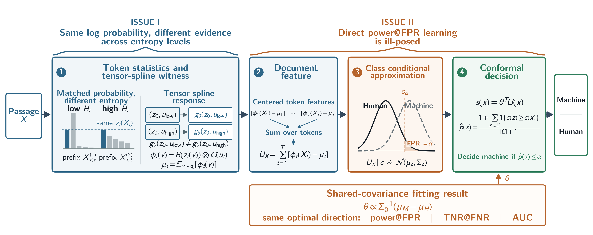

# Reformulating Data-Adaptive LLM-Generated Text Detection

Research code, paper data, and experiment artifacts for **“Reformulating Data-Adaptive
LLM-Generated Text Detection: A Class-Conditional Gaussian Approximation”** (under
review at ICLR 2027).

We formulate LLM-generated text detection as a fixed-human-FPR hypothesis test. The
detector represents token evidence with a two-dimensional tensor spline over token log
probability and prefix entropy, sums centered token features at passage level, and fits a
regularized inverse-covariance direction under a class-conditional Gaussian working
model. Independent human passages provide conformal operating-point calibration.



This `method_pipeline.png` is the image embedded in the paper's Figure 1. It is the
only figure image shipped in this repository; Figures 2 and 3 can be rebuilt from
their checked-in source scores and CSVs.

## Results

The evaluation covers 20 source-model/dataset configurations: LLaMA-2-7B,
OPT-2.7B, OPT-6.7B, and Falcon-7B on C4, PubMedQA, SQuAD, WritingPrompts, and
XSum. Each configuration uses 500 training pairs, 500 independent human calibration
passages, and 500 human plus 500 machine test passages.

| Setting | Fast-DetectGPT | AdaDetectGPT | Ours |
|---|---:|---:|---:|
| White-box AUROC | 0.7730 | 0.8244 | **0.8374** |
| Black-box AUROC | 0.6841 | 0.7421 | **0.7701** |

The method reduces AUROC error relative to AdaDetectGPT by 7.4% in white-box and
10.9% in strict proxy-model black-box evaluation. Full tables and artifact provenance
are in [docs/results.md](docs/results.md) and [docs/repository-layout.md](docs/repository-layout.md).

## Installation

Python 3.10 and a CUDA-capable PyTorch installation are recommended. Create an
environment and install the lightweight dependencies with:

```bash
python -m venv .venv
source .venv/bin/activate
pip install -r requirements.txt
```

Install the PyTorch build matching your CUDA version separately. The original runs used
large GPU models; cache-only rescoring, table generation, and diagnostics run on CPU.

## Reproducing reported artifacts

Regenerate the consolidated paper tables and paired statistical comparisons from the
checked-in outputs:

```bash
python scripts/build_paper_tables.py
python scripts/build_table_8.py
python scripts/paired_comparisons.py
```

Run cache-only white-box and black-box factorial experiments with:

```bash
PYTHONPATH=src python experiments/run_whitebox_factorial_ltheta.py --help
PYTHONPATH=src python experiments/run_blackbox_factorial_ltheta.py --help
```

Validate the included train, calibration, independent-test, and black-box adapter data:

```bash
python scripts/audit_paper_data.py
python scripts/make_paper_figures.py
python -m unittest discover -s tests -v
```

The included text inputs and their SHA-256 inventory are described in
[docs/data.md](docs/data.md). Model checkpoints and multi-gigabyte token caches must be
provided locally to rerun model scoring; the checked-in per-document scores support
table and figure regeneration without GPUs.

Paths in the packaged metadata are repository-relative. Model weights and large
derived caches are expected under `models/` and `cache/` respectively and are not
included in the repository.

## Repository layout

```text
src/          shared tensor-spline and cache code
experiments/  generation, fitting, evaluation, ablation, and diagnostic runners
scripts/      paper-table and statistical-summary utilities
results/      authoritative paper outputs and per-configuration scores
data/         train/calibration/test text, black-box adapters, frozen fits, manifests
figures/      the paper's Figure 1 image, method_pipeline.png
tests/        CPU-only checks for split integrity and paper tables
docs/         protocol, data, results, and provenance documentation
```

## Evaluation protocol

- Generation: 120-token prompt, 150–200 total tokens, top-k 50, temperature 1,
  top-p 1, and at least 55 generated words.
- White-box: source model is both the reference and scoring model.
- Black-box: GPT-J-6B is the reference proxy and GPT-Neo-2.7B is the scorer.
- Primary score: unnormalized linear score `T_theta(X) = theta^T U_X`.
- Random seed: `20260729` for the main experiment protocol.
- Fast-DetectGPT uses the official 10,000-candidate configuration;
  AdaDetectGPT uses exact conditional moments.

## Acknowledgements

This implementation builds on ideas and evaluation code from
[Fast-DetectGPT](https://github.com/baoguangsheng/fast-detect-gpt) and
[AdaDetectGPT](https://github.com/Mamba413/AdaDetectGPT). Please cite those works when
using the corresponding baselines.

## Citation

The paper is currently under anonymous review. A BibTeX entry will be added after the
review process.
